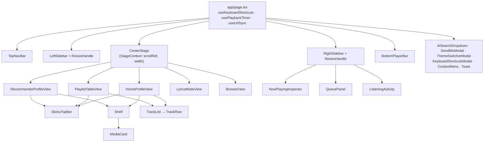
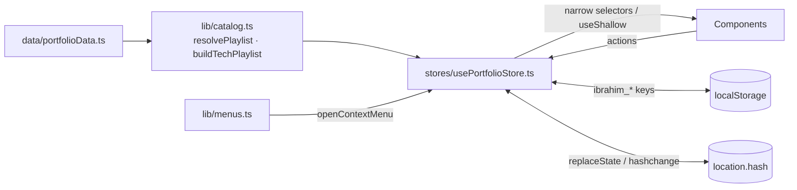

# 05 · Architecture

## Component tree

Shared primitives (`common/`): `Icons`, `IconButton`, `Tooltip`, `SpotifyButton` / `spotifyButtonClasses`, `PlayButton`, `CoverArt`, `Slider`, `FitTitle`, `ContextMenu`, `Toast`; plus `modals/Dialog`.

## Data flow

## Key ideas

### 1. Playlists are resolved, not stored
`resolvePlaylist(id, recruiterMix)` is the only way the UI gets a playlist. It knows three kinds:
- **Static sections** (`featured-projects`, `education`…) straight from the data.
- **`recruiter-mix`**: built from the saved ids, in the order they were saved, ignoring unknown ids.
- **`tech:<id>`**: "This Is &lt;tech&gt;", built by matching each technology's `keywords` at word starts against every track's title, subtitle, details and credits. `catalog.test.ts` checks every tech yields at least one track.

New sections need no new code: add them to `allPlaylists` and give them an art glyph in `CoverArt.PLAYLIST_ART`.

### 2. Play context and the queue
`setCurrentTrack(track, autoPlay, contextId?)` records `playContextId`. Without an explicit context it keeps the current one if it contains the track, otherwise it uses the track's own playlist.

`computeQueue(state)` is a **pure** function: context tracks → shuffle order, reconciled with added or removed mix items → the slice after the current track, wrapped when repeat is `context`. Because it's pure and returns stable track references, components can subscribe with `useShallow(computeQueue)`. Keep it *outside* object selectors (see bug 25 in [03](03-bugs-found-and-fixed.md)).

### 3. Timing
`durationSeconds` depends on the view: 30s for tracks, `LYRICS_DURATION_SECONDS` (word count ÷ 3) for the cover letter. On a view change the store rescales `currentTimeSeconds` so the progress *fraction* is kept. Stanza boundaries are `stanzaStartFractions`, weighted by length.

### 4. Navigation and URLs
The in-app history stack (`history[]`, `historyIndex`) stays the source of truth for the ‹ › buttons. `useUrlSync` mirrors the current view into `location.hash` with `replaceState` (no extra browser-history entries). On load it calls `restoreView(entry)`, which seeds `[home, entry]` so Back still works, and it listens for `hashchange` (pasted links). Routes are listed in [07](07-interaction-spec.md#urls).

### 5. Rendering discipline
- No component subscribes to the whole store. Use `usePortfolioStore(s => s.x)` or `useShallow` for several primitives.
- Scroll-driven UI (`StickyTopBar`, the sticky track header) reads `useStageScroll()`, which uses rAF throttling and is local to the component that calls it.
- Stage width comes from one `ResizeObserver` in `CenterStage` and drives the shelf column count, the track-table column count and the availability note.

### 6. Overlays
- **Context menu:** one global instance; callers pass items via `openMenuAt(event, items)` (pointer position for right-click, under the button for "…").
- **Dialogs** use `Dialog` (focus in, trap, restore).
- **Search** is a non-modal anchored dropdown positioned from the pill's `getBoundingClientRect()`. Click-away ignores menus and dialogs opened from it.
- **Escape** is handled once, in `useKeyboardShortcuts` → `closeTopmostOverlay()`.

### 7. Theming
`accentThemes` → `applyThemeVariables()` sets `--accent-primary/hover/pressed`, `--banner-gradient` and `--banner-color`. Tailwind's `accent` colours point at those variables (`bg-accent`, `text-accent`, `bg-accent-hover`). `layout.tsx` inlines a boot script generated from the same `accentThemes`, so there's no flash and no duplicated hex values.

### 8. Persistence (`localStorage`)

| Key | Contents |
|---|---|
| `ibrahim_recruiter_mix` | `string[]` of saved track ids, validated on load |
| `ibrahim_accent_theme` | `AccentThemeId` |
| `ibrahim_player_prefs` | `{ shuffle, repeat, volume, isMuted, isLibraryCollapsed, leftSidebarWidth, rightSidebarWidth, isRightSidebarOpen, trackListDensity }`, type-checked and clamped |

All access is wrapped in `try/catch` (private mode, quota).
